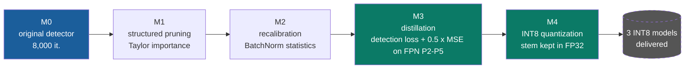

<p align="center">
  
</p>

<p align="center">
  
</p>

<p align="center">
  
  
  
  
  
</p>


<p align="center">
  
</p>

---

## At a glance

<table align="center">
  <tr>
    <td align="center" width="25%"><h2>101.1 %</h2><sub>of the original AP kept after removing <b>41.8 %</b> of the parameters<br/>(95.6 % against the detector retrained with the same recipe)</sub></td>
    <td align="center" width="25%"><h2>9.1×</h2><sub>smaller: <b>165.6 MB → 18.2 MB</b><br/>for the maximal model in INT8</sub></td>
    <td align="center" width="25%"><h2>80.2 %</h2><sub>of the original accuracy kept by that<br/>maximal INT8 model</sub></td>
    <td align="center" width="25%"><h2>3</h2><sub>final <b>INT8 models</b> delivered,<br/>from 45.8 MB to 18.2 MB</sub></td>
  </tr>
</table>

---

## Why this exists

<table>
  <tr>
    <td width="33%" valign="top"><h4>🧗 Before</h4>A technician climbs the pylon to look at each insulator. Slow, costly, and dangerous.</td>
    <td width="33%" valign="top"><h4>☁️ Drone + cloud</h4>A drone films the line and sends images to a server. Safer, but nothing works without a network.</td>
    <td width="33%" valign="top"><h4>🧠 Edge AI (this project)</h4>The detector runs <b>on the drone</b>. For that it must be small, so this framework compresses it while measuring what it costs.</td>
  </tr>
</table>

The detector finds insulators on UAV images and tells whether each is **healthy** (*No issues*), **broken** (*Broken*) or damaged by an electric arc (*Flashover damage*). The original network (Faster R-CNN, ResNet-50-FPN, 41.3 M parameters, AP 71.19 on 320 test images) is too heavy for a small onboard computer.

This repository belongs to a TinyML / Edge AI internship (EMG Rabat). Models are compared by **retention**: the AP of the compressed model divided by the AP of the original detector.

---

## The pipeline



| Step | What it does | Plain words |
|---|---|---|
| **M1 pruning** | Removes the channels with the lowest Taylor score, `I_c = \|W_c ∂L/∂W_c\|`, with a global rank across layers | Trim the branches that matter least. The network gets smaller but breaks (0.7 % retention at 41.8 %). |
| **M2 recalibration** | Recomputes BatchNorm statistics on images | Re-adjust the internal settings. Helps a little when pruning is mild. |
| **M3 distillation** | Retrains the pruned student to imitate the teacher on FPN levels P2 to P5, plus the detection loss | The big network teaches the small one. This is where almost everything is repaired. |
| **M4 INT8** | Post-training quantization, first layer (stem) kept in FP32 | Write the numbers on 8 bits instead of 32. Quantizing the stem alone costs 20.6 points, so it stays in FP32. |

> **The recovery recipe.** The *final recipe* of M3 is 1,600 iterations, training at 640 to 800 px, all layers trainable. The earlier *base recipe* was 800 iterations, 480 to 576 px, stem and `res2` frozen. Same aggressive student: **69 % → 85.4 % retention**, so a retention figure only means something together with its recipe.

---

## Results

*320 test images of IDID V1.2, one run unless stated.*

| Model | Parameters removed | AP (0 to 1) | Retention |
|---|---:|---:|---:|
| Original detector M0 | 0 % | 0.7119 | 100 % |
| M0 retrained with the same recipe (control) | 0 % | 0.7528 | 105.7 % |
| Whole backbone, critical modules protected | 41.8 % | 0.7199 | **101.1 %** |
| Whole backbone, INT8 (stem in FP32), **45.8 MB** | 41.8 % | 0.7197 | 101.1 % |
| Aggressive (mean of 3 seeds) | 57.6 % | 0.6101 | 85.7 % |
| Aggressive, INT8 (stem in FP32), **24.0 MB** | 57.6 % | 0.6020 | 84.6 % |
| Uniform allocation, same reduction | 57.6 % | 0.7032 | **98.8 %** |
| Maximal | 61.7 % | 0.5751 | 80.8 % |
| Maximal, INT8 (stem in FP32), **18.2 MB** | 61.7 % | 0.5712 | 80.2 % |

<details>
<summary><b>Why more than 100 %?</b></summary>

The recovery stage is extra training that the original detector never received. To check it, the unpruned detector was retrained with the same recipe: it reaches AP 0.7528 (105.7 %). Against that control, the 41.8 % model keeps **95.6 %**, which is the honest number.
</details>

<details>
<summary><b>A result that went against the hypothesis</b></summary>

At the same 57.6 % reduction and the same recipe, the **uniform** allocation (98.8 %) beat the allocation that protects the stem, RPN and heads (85.4 %) and the head-protected one (82.9 %). A likely reason is that the RoI head holds many parameters for only three classes and looks redundant, but no separate experiment isolates it and each value comes from a single run.
</details>

### What compression costs

The average hides an inequality: healthy insulators stay well detected, damage classes do not.

<p align="center">
  
</p>

Most of the loss comes from class confusions (a damaged insulator labelled healthy). Failure images are in the report (section *Failure Images*).

### A second architecture

The same framework, on ResNet-18 (Imagenette): 81 % of the parameters removed, 95.0 % → 92.3 % accuracy after INT8, **20.5× smaller** (44.8 MB → 2.19 MB). Taylor was the best of four importance criteria between 50 % and 80 % reduction on this model.

---

## The three delivered models

| Model | Parameters removed | Weights FP32 → INT8 | AP (INT8) | Retention (INT8) |
|---|---:|---:|---:|---:|
| **Whole backbone** | 41.8 % | 96.4 → 45.8 MB | 0.7197 | **101.1 %** |
| **Aggressive** | 57.6 % | 70.2 → 24.0 MB | 0.6020 | **84.6 %** |
| **Maximal** | 61.7 % | 63.3 → 18.2 MB | 0.5712 | **80.2 %** |

Retention = AP of the model / AP of the original detector (0.7119), on the 320 test images. Sizes are the serialized weights (`state_dict`); the original detector is 165.6 MB.

---

## Interactive page and video

- **Interactive page**: [open the page](https://meryem-labyad.github.io/TinyML_Framework/) (source: [`index.html`](index.html)). Build your own model with the compression sliders and see the accuracy/size trade-off.
- **Demo video** (1 min 47, English): see the project post on LinkedIn.
- The clips in the video are AI-generated and the scores shown in the detection demo are simulated.

---

## Quick start

```bash
git clone https://github.com/MERYEM-LABYAD/TinyML_Framework.git
cd TinyML_Framework
pip install -r requirements.txt
pip install 'git+https://github.com/facebookresearch/detectron2.git' --no-build-isolation
```

Python 3.11+ and a CUDA GPU are recommended for training steps (CPU is enough for evaluation and quantization).

<details>
<summary><b>Reproduce the detector pipeline</b></summary>

```bash
python verify_m0_8000.py                       # gate: M0 must give AP 71.19
python run_m1_report.py prune --config expose_whole_backbone --target-reduction 41.8 --clip rank
python run_m2_report.py recalibrate --m1 m1_report/checkpoints/M1R_expose_whole_backbone_t41.8_crank.pth
python run_m3_report.py distill --m2 m1_report/checkpoints/M2_expose_whole_backbone_t41.8_crank_matched.pth \
       --iters 1600 --threads 4 --min-size 640,704,768,800 --max-size 1333 --freeze-at 0 --tag v5pure
python run_m4_report.py quantize --m3 m1_report/checkpoints/M3_maximal_t61.7_crank_matched_v5pure.pth \
       --threads 4 --fp32-units stem
python evaluate_m1_report.py --checkpoint <path to a .pth>
```

The tag `v5pure` is the final recipe. Pruning configurations: `expose_residual` (18.4 %), `expose_internal` (31.5 %), `expose_whole_backbone` (41.8 %), `aggressive` (57.6 %), `maximal` (61.7 %), `protect_head`, `uniform_local`.
</details>

<details>
<summary><b>Reproduce the ResNet-18 study</b></summary>

```bash
python run_resnet18_framework.py prepare --dataset imagenette --out r18_report --img-size 128
python run_resnet18_framework.py pipeline --engine framework --pipe-epochs 15 --dataset imagenette --out r18_report --img-size 128
```
</details>

<details>
<summary><b>Use the framework on another model</b></summary>

```python
from tinyml.core.framework import TinyMLFramework
```

Register the model through an adapter, rank channels with an importance class and the global ranker, build a `PruningPolicy`, and prune with `StructuredPruner`. `run_resnet18_framework.py` is a complete working example (`make_framework`, `fw_register`, `prune_model_fw`, `fw_validate`).
</details>

---

## Data and weights (not stored in Git)

GitHub refuses files above 100 MB, and the original detector is 165.6 MB, so weights live outside the repository and are checked by hash.

| Item | Where | Check |
|---|---|---|
| IDID V1.2 images and annotations | Dataset owner (follow its licence). Set `TINYML_JSON_DIR` and `TINYML_IMAGES`. | n/a |
| **Original detector M0** (8,000 iterations) | Repository *Releases* page, or the Kaggle dataset used for the experiments. Set `TINYML_M0`. | SHA-256 `740FFEB4C02BE3658DE1E3CC486588BE16B83BC1150592DAE4D69C5984B9BB8E` (every script verifies it) |
| Student checkpoints (about 70 MB each) | Not tracked | Hashes in [`docs/CHECKPOINTS_SHA256.csv`](docs/CHECKPOINTS_SHA256.csv) |

Environment variables: `TINYML_ROOT`, `TINYML_M0`, `TINYML_JSON_DIR`, `TINYML_IMAGES`, `TINYML_FASTER`, `TINYML_DEVICE` (`cpu` to force the CPU).

---

## Repository layout

```
TinyML_Framework/
├── tinyml/                     the framework
│   ├── adapters/               Detectron2, torchvision, plain PyTorch
│   ├── core/                   entry point, model analyzer, registry
│   ├── dependency/             dependency graph and channel groups
│   ├── importance/             Taylor, magnitude, activation, hybrid, global ranker
│   ├── pruning/                policy, protection, structured pruner, validator
│   └── distillation/ evaluation/ quantization/ recovery/ visualization/
├── run_m1_report.py … run_m4_report.py   the four steps
├── verify_m0_8000.py           gate on the original detector
├── evaluate_m1_report.py       evaluation of any checkpoint
├── measure_costs.py            parameters, size, GFLOPs, latency
├── run_resnet18_framework.py   ResNet-18 through the framework
├── run_resnet18_study.py       ResNet-18 with Torch-Pruning called directly (control)
├── benchmark_on_device.py      latency, memory, temperature on a target device
├── m1_report/                  detector results: logs, tables, figures
├── r18_report/                 ResNet-18 results
├── docs/                       file index, checkpoint hashes, methodology notes
└── tests/
```

## Next: onboard hardware

<p align="center"> </p>

The INT8 model is 18.2 MB, so memory is not the issue on a Raspberry Pi 5 (4-core Arm, 8 GB, no CUDA GPU). Speed is the open question: the best figure so far is about 5 seconds per image on a laptop CPU, which is **not real time**. The report (appendix *Embedded Platforms and Integration Path*) describes the steps: quantize with the `qnnpack` backend, export to TorchScript or ONNX, check that AP is unchanged, then measure latency, memory, temperature and energy. `benchmark_on_device.py` is ready:


## Author

**Meryem Labyad**, engineering student at EMG Rabat, TinyML / Edge AI internship.

<p align="center">
  
</p>
